# PawBalik Entity-Relationship Diagram

Generated from the SQLAlchemy models in `app/models/` (the same source as `database/schema.sql`).

```mermaid
erDiagram
  assistance_providers {
    int id PK
    varchar name
    enum type
    varchar address
    varchar barangay
    double lat
    double lng
    varchar phones
    varchar facebook_url
    varchar hours_text
    bool is_24_7
    text services
    bool is_active
    bool is_sample
    datetime created_at
    datetime updated_at
  }
  case_counters {
    int year PK
    int last_value
  }
  jobs {
    int id PK
    varchar type
    json payload
    enum status
    int attempts
    text last_error
    datetime run_after
    datetime locked_at
    datetime created_at
    datetime updated_at
  }
  photos {
    int id PK
    enum owner_type
    int owner_id
    enum storage
    varchar public_id UK
    varchar secure_url
    int width
    int height
    varchar sha256
    bool is_primary
    int sort_order
    json ai_attributes
    datetime created_at
  }
  users {
    int id PK
    varchar full_name
    varchar email UK
    varchar mobile_e164 UK
    datetime mobile_verified_at
    varchar password_hash
    enum role
    bool is_active
    bool sms_opt_in
    bool push_opt_in
    datetime last_login_at
    datetime privacy_consented_at
    datetime created_at
    datetime updated_at
  }
  audit_logs {
    int id PK
    int actor_id FK
    varchar event
    varchar target_type
    int target_id
    varchar ip
    json details
    datetime created_at
  }
  device_tokens {
    int id PK
    int user_id FK
    varchar fcm_token UK
    varchar user_agent
    datetime last_seen_at
    datetime created_at
  }
  image_comparisons {
    int id PK
    varchar query_sha256
    int candidate_photo_id FK
    varchar model_name
    json result
    datetime created_at
  }
  lost_reports {
    int id PK
    varchar case_number UK
    int owner_id FK
    varchar pet_name
    enum species
    varchar breed
    varchar colors
    enum size
    enum sex
    varchar age_text
    text identifying_features
    double last_seen_lat
    double last_seen_lng
    varchar last_seen_place
    datetime last_seen_at
    varchar contact_name
    varchar contact_email
    varchar contact_phone
    bool show_phone
    decimal reward_amount
    varchar reward_text
    enum status
    bool is_hidden
    varchar hidden_reason
    int hidden_by FK
    datetime hidden_at
    json ai_attributes
    datetime created_at
    datetime updated_at
  }
  notifications {
    int id PK
    int user_id FK
    varchar type
    varchar title
    varchar body
    varchar link_url
    bool is_read
    datetime created_at
  }
  phone_verifications {
    int id PK
    int user_id FK
    varchar mobile_e164
    varchar code_hash
    datetime expires_at
    int attempts
    datetime consumed_at
    datetime created_at
  }
  sightings {
    int id PK
    int finder_id FK
    enum species
    varchar breed
    varchar colors
    enum size
    enum condition
    bool is_holding_animal
    text notes
    double seen_lat
    double seen_lng
    varchar seen_place
    datetime seen_at
    varchar contact_name
    varchar contact_email
    varchar contact_phone
    enum contact_pref
    enum status
    bool is_hidden
    varchar hidden_reason
    int hidden_by FK
    datetime hidden_at
    json ai_attributes
    datetime expires_at
    datetime created_at
    datetime updated_at
  }
  sms_log {
    int id PK
    int user_id FK
    varchar to_number
    varchar message
    varchar purpose
    varchar provider
    varchar provider_message_id
    varchar status
    text error
    datetime created_at
  }
  case_status_history {
    int id PK
    int lost_report_id FK
    enum from_status
    enum to_status
    int changed_by FK
    varchar note
    datetime changed_at
  }
  conversations {
    int id PK
    int lost_report_id FK
    int sighting_id FK
    int owner_id FK
    int other_user_id FK
    datetime created_at
    datetime last_message_at
  }
  push_log {
    int id PK
    int user_id FK
    int token_id FK
    varchar title
    varchar status
    text error
    datetime created_at
  }
  rescue_requests {
    int id PK
    int user_id FK
    int lost_report_id FK
    int sighting_id FK
    int provider_id FK
    text summary_text
    datetime created_at
  }
  scans {
    int id PK
    int user_id FK
    enum mode
    enum trigger
    int query_photo_id FK
    int source_lost_report_id FK
    int source_sighting_id FK
    double scan_lat
    double scan_lng
    json precheck
    json attributes
    enum status
    text error
    int result_count
    bool gemini_ok
    datetime completed_at
    datetime created_at
  }
  abuse_reports {
    int id PK
    int reporter_id FK
    int target_user_id FK
    int conversation_id FK
    text reason
    enum status
    datetime created_at
  }
  messages {
    int id PK
    int conversation_id FK
    int sender_id FK
    enum type
    text body
    double lat
    double lng
    varchar location_label
    int photo_id FK
    datetime read_at
    datetime created_at
  }
  scan_results {
    int id PK
    int scan_id FK
    enum candidate_type
    int candidate_id
    int candidate_photo_id FK
    float visual_score
    float attribute_score
    float distance_km
    float distance_score
    float recency_score
    float final_score
    enum tier
    int rank
    bool visual_check_unavailable
    json explanation
    datetime notified_at
    datetime created_at
  }
  sighting_access_log {
    int id PK
    int sighting_id FK
    int viewer_id FK
    int scan_id FK
    datetime accessed_at
  }
  assistance_providers ||--o{ rescue_requests : "provider_id"
  conversations ||--o{ abuse_reports : "conversation_id"
  conversations ||--o{ messages : "conversation_id"
  device_tokens ||--o{ push_log : "token_id"
  lost_reports ||--o{ case_status_history : "lost_report_id"
  lost_reports ||--o{ conversations : "lost_report_id"
  lost_reports ||--o{ rescue_requests : "lost_report_id"
  lost_reports ||--o{ scans : "source_lost_report_id"
  photos ||--o{ image_comparisons : "candidate_photo_id"
  photos ||--o{ messages : "photo_id"
  photos ||--o{ scan_results : "candidate_photo_id"
  photos ||--o{ scans : "query_photo_id"
  scans ||--o{ scan_results : "scan_id"
  scans ||--o{ sighting_access_log : "scan_id"
  sightings ||--o{ conversations : "sighting_id"
  sightings ||--o{ rescue_requests : "sighting_id"
  sightings ||--o{ scans : "source_sighting_id"
  sightings ||--o{ sighting_access_log : "sighting_id"
  users ||--o{ abuse_reports : "reporter_id"
  users ||--o{ abuse_reports : "target_user_id"
  users ||--o{ audit_logs : "actor_id"
  users ||--o{ case_status_history : "changed_by"
  users ||--o{ conversations : "other_user_id"
  users ||--o{ conversations : "owner_id"
  users ||--o{ device_tokens : "user_id"
  users ||--o{ lost_reports : "hidden_by"
  users ||--o{ lost_reports : "owner_id"
  users ||--o{ messages : "sender_id"
  users ||--o{ notifications : "user_id"
  users ||--o{ phone_verifications : "user_id"
  users ||--o{ push_log : "user_id"
  users ||--o{ rescue_requests : "user_id"
  users ||--o{ scans : "user_id"
  users ||--o{ sighting_access_log : "viewer_id"
  users ||--o{ sightings : "finder_id"
  users ||--o{ sightings : "hidden_by"
  users ||--o{ sms_log : "user_id"
```

## Tables

- **`assistance_providers`** — Rescuers, vets and shelters (SAMPLE entries are flagged).
- **`case_counters`** — One row per year; transaction-safe case-number sequence.
- **`jobs`** — Background job queue processed by `python run.py worker`.
- **`photos`** — Every uploaded image (reports, sightings, scans, messages); Cloudinary or local; SHA-256 and cached AI attributes.
- **`users`** — Accounts (citizens and admins). Mobile stored as E.164; `mobile_verified_at` set by OTP.
- **`audit_logs`** — Security-relevant events (logins, admin actions, sighting access).
- **`device_tokens`** — Firebase Cloud Messaging tokens per browser.
- **`image_comparisons`** — Cache of Gemini visual comparisons (query hash × candidate photo × model).
- **`lost_reports`** — Lost Pet Reports with unique `case_number` (PB-YYYY-NNNNNN) and status lost/found/closed.
- **`notifications`** — In-app notifications (possible_match, new_message, case_status_changed).
- **`phone_verifications`** — Hashed one-time codes for mobile verification.
- **`sightings`** — Private Pet Sightings from finders (active/matched/expired).
- **`sms_log`** — Every SMS attempt (match alerts, OTP).
- **`case_status_history`** — Every status change of a report, with actor and note.
- **`conversations`** — Case-scoped chat between a report owner and one other user.
- **`push_log`** — Every push attempt.
- **`rescue_requests`** — Logged 'Request Rescue Help' summaries.
- **`scans`** — Each Found/Lost Pet Scanner run (manual or background) with Gemini pre-check and attributes.
- **`abuse_reports`** — 'Report this user' submissions for admin review.
- **`messages`** — Text, location pin, image and system messages.
- **`scan_results`** — Ranked candidates of a scan with every score component and the explanation.
- **`sighting_access_log`** — Who viewed which private sighting, via which scan.
